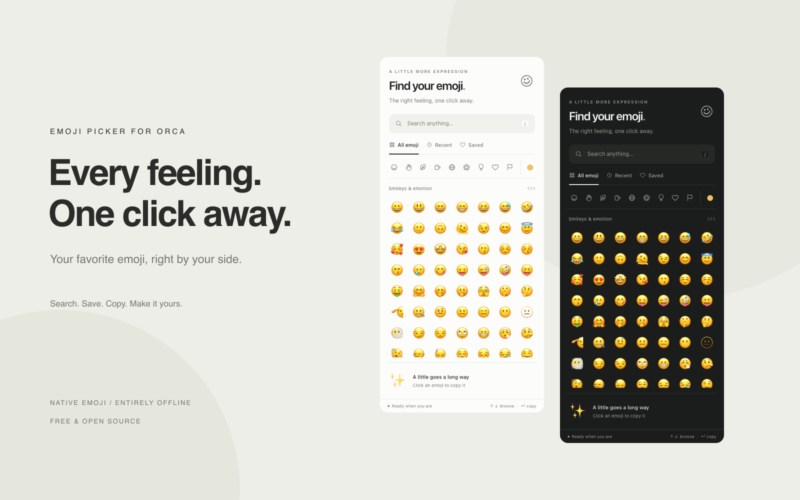

# Emoji Picker for Orca

A quiet little place to find the right feeling. A free, offline emoji picker in Orca's right sidebar, by [AmethystLiang](https://github.com/AmethystLiang).



## Install

Requires **Orca 1.4.246 or later**. Open [the plugin page](https://www.onorca.dev/plugins/AmethystLiang/orca-plugin), or install with the Orca CLI:

```sh
orca plugin install AmethystLiang/orca-plugin@v1.0.0
```

Review and approve the sandboxed panel when Orca asks. It requests **no host capabilities**. Open **Emoji Picker** from the star icon in the right sidebar. From the CLI:

```sh
orca plugin open amethystliang.emoji-picker
```

## Make it yours

- **Find anything.** Search names, keywords, emoji, and GitHub shortcodes such as `:rocket:` or `:+1:`. Multiword queries work too.
- **Copy in a click.** Click an emoji, then paste it wherever you like. If clipboard access is unavailable, a dialog lets you copy the text manually.
- **Keep the good ones.** Hover or focus an emoji and click the heart in the preview to save it. Shift-click also saves it. Up to 100 saved emoji and the last 36 copied emoji stay on this device.
- **Choose a skin tone.** Use the dot beside the categories. Variants use the dataset's actual Unicode sequences.
- **Follow your theme.** Neutral light and dark styling uses Orca's colors and changes with your theme.
- **Use the keyboard.** `/` focuses search; Down moves from search into the grid; arrows move between emoji; Home/End move within a row; Ctrl/Cmd + Home/End move to the first/last emoji; Enter or Space copies; Escape dismisses the tone chooser and clears search.

The bundled catalog contains **1,923 base emoji**, plus skin variants. Native appearance depends on your OS and fonts. A small canvas check hides newer emoji that your color emoji font cannot draw; older emoji and flag support can also vary by OS.

## Built to stay light

No runtime dependencies, framework, worker process, fonts, image sprites, CDN, tracking, or external network requests. Emoji are native text; all data ships with the plugin.

The grid renders visible rows plus a small overscan window, with binary search to locate rows. Scrolling updates once per animation frame. Search strings are prepared once and exact shortcodes are ranked first. Storage is limited to preferences, saved items, and recent use in the plugin's isolated local storage; blocked or corrupt storage falls back safely.

In local Chromium tests at 360 × 780, the picker kept fewer than 160 emoji buttons mounted while scrolling through the full catalog. Ten searches including DOM updates took about 4 ms on the development machine. These are local measurements, not a guarantee for every device.

## Develop

The shipped plugin runs directly from the committed `panel/` files. No install or build is needed to use it.

```sh
npm ci
npm run build:data
npx playwright install chromium
npm run verify
orca plugin validate . --json
orca plugin dev load . --json
```

The last command prints the approval command for this development folder. Once approved, Orca reloads code changes as you save. Run `orca plugin shot local.emoji-picker --json` for a real sidebar screenshot.

The test suite covers search, skin sequences, malformed preferences, bounded virtual rendering, clipboard success/refusal, keyboard navigation, saved/recent persistence, empty states, responsive sizing, and theme rendering. GitHub Actions reruns the tests and verifies that bundled data is reproducible.

`orca plugin check` statically validates this HTML panel; the Playwright suite exercises the actual DOM. Some Orca versions' `plugin inspect` also scan ignored `node_modules/`; inspect a clean checkout or move development dependencies outside the plugin directory if it reports a symlink there.

## Open-source references

The implementation is written for this plugin. Research references:

- [Orca's official plugin-authoring guide](https://github.com/stablyai/orca/blob/main/docs/reference/plugin-authoring.md) and [Hello Orca panel](https://github.com/stablyai/orca/tree/main/examples/plugins/hello-orca) for the manifest, sandbox, sidebar contribution, and theme variables.
- [emoji-picker-element](https://github.com/nolanlawson/emoji-picker-element) for native emoji, accessibility, and keeping a picker lightweight.
- [Emoji Mart](https://github.com/missive/emoji-mart) for searchable categories, skin tones, and separating emoji data from UI.
- [Emojibase](https://github.com/milesj/emojibase) for the bundled English labels, tags, GitHub shortcodes, and skin sequences (`emojibase-data` 18.0.0, MIT). Its license is preserved in [assets/EMOJIBASE-LICENSE](assets/EMOJIBASE-LICENSE).

## License

[MIT](LICENSE).
